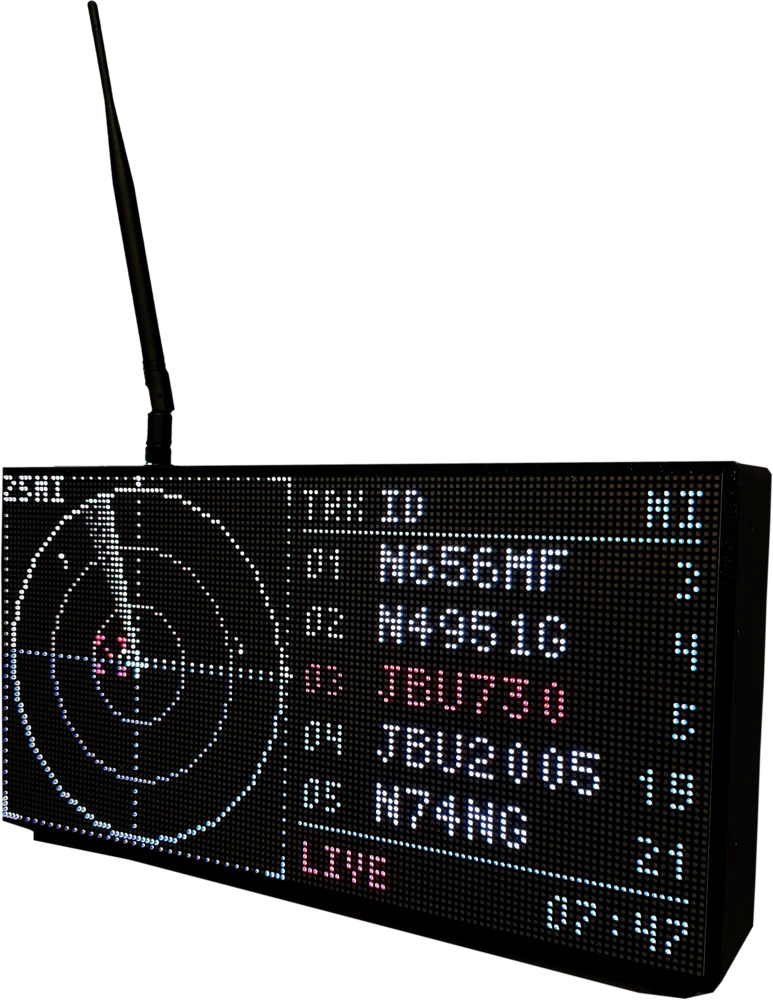
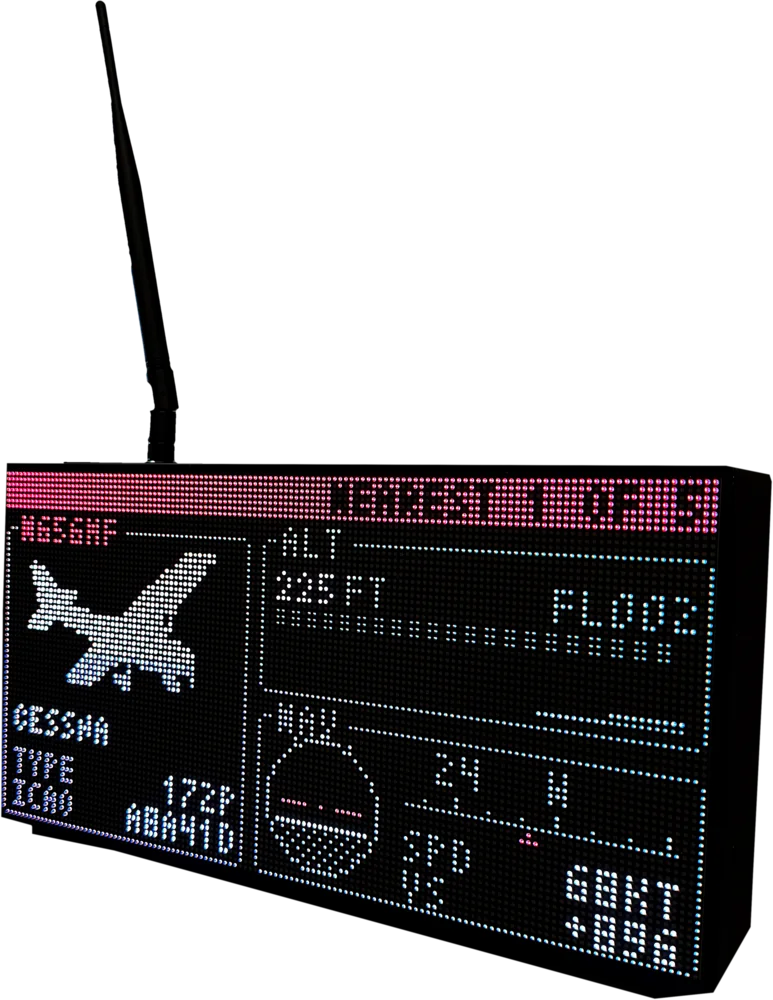

# FltCast

FltCast is a C++ ADS-B flight tracker built for Raspberry Pi and HUB75 RGB LED matrices.

It reads SBS aircraft data from port `30003`, enriches it with a local DB lookup, and renders it to a 128x64 display made of four 64x32 panels. A radar view maps the planes within range and lists the five nearest; for 10 seconds out of every 30, it switches to a detail screen for the nearest plane.

FltCast is designed to work with an RTL-SDR and any ADS-B decoder that provides an SBS/BaseStation-compatible stream, such as `dump1090-fa`.

<p align="center">
  
  &nbsp;&nbsp;&nbsp;&nbsp;
  
</p>

## What's New in v2

This is FltCast v2. The original single-panel version is on the [`v1` branch](https://github.com/bytecadia/FltCast/tree/v1).

- **4x the pixels:** four 64x32 P2.5 panels make a 128x64 display in the same footprint as v1's single panel
- **New UI:** a radar view of nearby planes with a list of the five nearest, plus a detail screen for the nearest plane
- **Aircraft-specific sprites** for common types like the A320, 737, 787, Cessna 172 and R44
- **Thinner case:** the antenna and power jack are now panel-mounted
- **Matrix settings in `config.ini`:** chain length, pixel mapper, refresh limit and GPIO slowdown are no longer hard-coded

## Parts List

*As an Amazon Associate, I earn from qualifying purchases.*

The Amazon links are there for convenience, but you may be able to find these parts cheaper elsewhere.

- [RTL-SDR](https://amzn.to/47ngHxq)
- [64x32 P2.5 LED Matrix](https://link.amazon/B09zRx6zl) (x4)
- [RGB Matrix Adapter Board](https://amzn.to/4hwtSAM)
- [5V 15A Power Supply](https://amzn.to/3TtoiXR)
- [USB-C Pigtail Cables](https://amzn.to/4iXFlMl)
- Raspberry Pi 4: Pi prices right now are outrageous, if you can get your hands on a Pi 4 with 1GB RAM that's plenty, but here's the link for a [reputable reseller that I used](https://link.amazon/B0gUnzBAM)
- [WAGO 221-413 Lever Connectors](https://amzn.to/4z2amDs)
- [5.5x2.1mm Panel-Mount DC Power Jack](https://link.amazon/B0cx1QTyA)
- [SMA Bulkhead Antenna Extension Cable](https://link.amazon/B0bvERtUQ)
- M3 and M2.5 heat-set threaded inserts and bolts
- [Case STLs](case)

## Build Guide

A more detailed step-by-step build guide is currently in progress. If you'd like to be notified when it's available, you can [join the waitlist here](https://bytecadia.kit.com/4a5f30c81c).

## Setup

### Disable the Raspberry Pi Audio Kernel Module

The RGB matrix library may conflict with the `snd_bcm2835` audio kernel module.

Check whether it is loaded:

```bash
lsmod | grep snd_bcm2835
```

If it is, unload it:

```bash
sudo modprobe -r snd_bcm2835
```

### Install Dependencies

```bash
sudo apt install git cmake rtl-sdr
```

## Install dump1090-fa

Install the FlightAware repository:

```bash
wget https://www.flightaware.com/adsb/piaware/files/packages/pool/piaware/f/flightaware-apt-repository/flightaware-apt-repository_1.3_all.deb

sudo dpkg -i flightaware-apt-repository_1.3_all.deb
sudo apt update
sudo apt install dump1090-fa
```

Restart and verify the service:

```bash
sudo systemctl restart dump1090-fa
sudo systemctl status dump1090-fa
```

Reboot after installation:

```bash
sudo reboot
```
## Build and Run

```bash
cmake -S . -B build
cmake --build build
```

Run:
```bash
sudo ./build/flight_cast
```

## Start Service

Write the systemd service file. Update with the location of the repository.
```
[Unit]
Description=FltCast

[Service]
Type=simple
WorkingDirectory=/path/to/fltcast
ExecStart=/path/to/fltcast/build/flight_cast
Restart=on-failure
RestartSec=5

[Install]
WantedBy=multi-user.target
```

Start the service
```
sudo systemctl daemon-reload
sudo systemctl enable --now fltcast
```

## Configuration

FltCast reads its runtime settings from an INI configuration file. In the repo root as "config.ini". The following are the current config options:

### Network

`host` and `port` define the SBS/BaseStation stream used by FltCast.

For a local `dump1090-fa` installation:

```ini
[network]
host = localhost
port = 30003
```

### Location

Set `lat` and `lon` to the location you're running from. This is used to calculate the planes distance from you.

```ini
[location]
lat = 40.7128
lon = -74.0060
```

### Fonts

(You shouldn't need to mess with these.)

```ini
[font]
sml = tom-thumb
med = 4x6
lrg = 5x8
```

### Matrix Layout

`cols` and `rows` are the size of one panel. `chain_length` is how many panels are chained, and `pixel_mapper` arranges them; `U-mapper` turns a chain of four into a 128x64 display. `limit_refresh` (Hz) and `gpio_slowdown` are passed to the RGB matrix library and may need tuning for your Pi model.

```ini
[matrix]
cols = 64
rows = 32
chain_length = 4
parallel = 1
pixel_mapper = U-mapper
limit_refresh = 300
gpio_slowdown = 5
padding = 2
row_gap = 0
img_span = 2
img_height = 14
```

### Radar

`range` is the radar radius in miles. Only planes within this distance are shown.

```ini
[radar]
range = 25
```

## AI Usage

This project was written entirely by hand, with the exception of a few small utility functions. I spent weeks architecting the program from end to end before writing it. 

So if the code is bad, that's all me :)